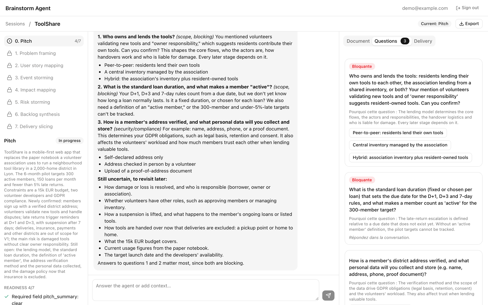
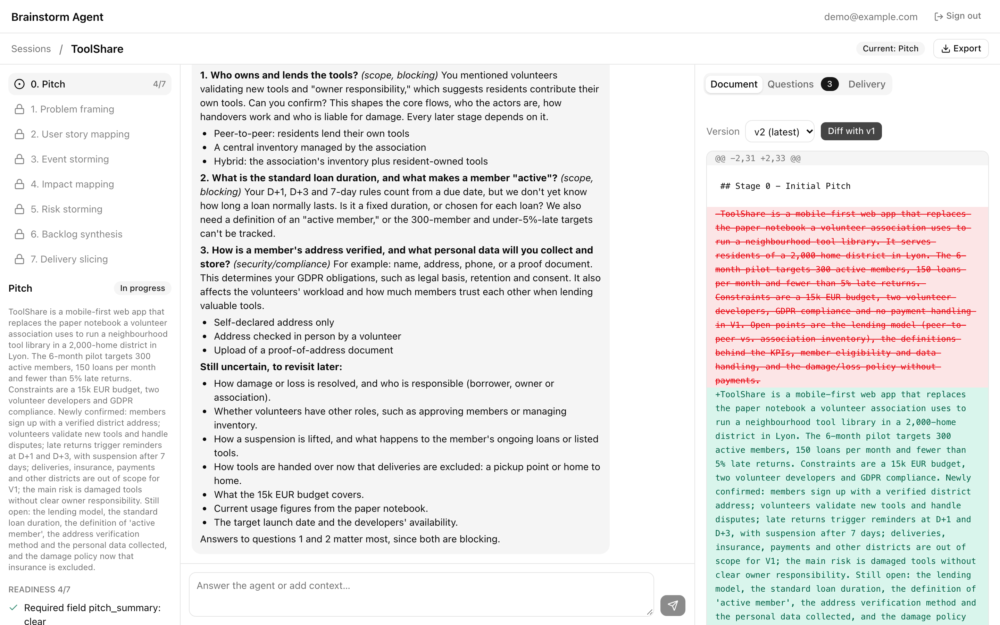
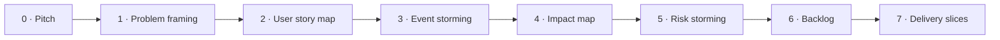
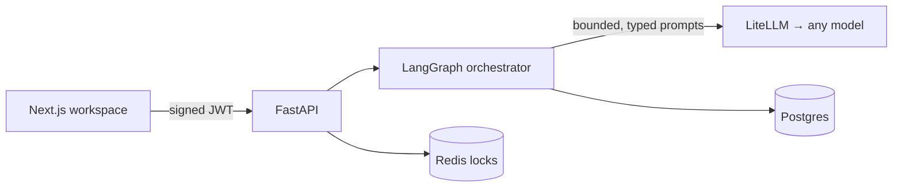

<div align="center">

# 🧭 brainstorm-agent

**From a vague pitch to a framed, sliced, ready-to-build backlog. One strict stage at a time.**

[](https://github.com/Guillaume-Lombardo/brainstorm-agent/actions/workflows/ci.yml)


[](LICENSE)


<sub>Real run with Claude Opus 5.5, model waits sped up. <a href="docs/assets/demo.mp4">Full-quality video</a></sub>

</div>

Most AI assistants jump straight to solutions. **brainstorm-agent** does not. It runs you through
eight framing workshops, refuses to move on while answers are vague or contradictory, and keeps a
versioned document for every stage.

- 🪜 **Eight fixed stages**, from the pitch to delivery slices. No skipping.
- 🚦 **Quality gates in code**: required fields, measurable objectives and blocking questions are
  checked deterministically before any transition.
- 📄 **Living documents**: facts, assumptions, decisions, risks and open questions, versioned with
  diffs, exported as Markdown or JSON.
- 🔎 **Similar products research** during problem framing, with sources.
- 🔌 **Model-agnostic**: any OpenAI-compatible endpoint (through LiteLLM), and usable itself as an
  OpenAI-compatible model from OpenWebUI.

## 🚀 Try it in two minutes

You need Docker with Compose v2.

```bash
git clone https://github.com/Guillaume-Lombardo/brainstorm-agent.git
cd brainstorm-agent
docker compose up --build
```

Open **<http://localhost:3000>** and sign in with the demo account:

| Email | Password |
|---|---|
| `demo@example.com` | `brainstorm-demo` |

Out of the box, the stack runs an **offline stub model**: no API key, deterministic answers. It reads
`key: value` lines, so start a session with:

```text
pitch: A weekly meal planner that builds the shopping list
clear: weekly plan, shopping list
ambiguous: budget handling
missing: pricing model
```

### With a real model

Point the bundled LiteLLM gateway at any OpenAI-compatible API:

```bash
LLM_MODE=openai \
LLM_UPSTREAM_BASE_URL=https://api.openai.com/v1 \
LLM_UPSTREAM_API_KEY=sk-... \
MODEL_NAME=<model-name> \
docker compose up --build
```

For Anthropic models behind a compatible gateway, add `LLM_OUTPUT_MODE=json_object`.

## 🖼️ Screenshots

| Blocking questions first, with suggested answers | Every stage document is versioned and diffable |
|---|---|
|  |  |

## 🪜 The workflow



Each turn returns a summary, the open questions, the next targeted questions and a new version of the
stage document. A stage closes only when its gate passes (and, if enabled, after a human review).

## 🏗️ Under the hood



The orchestrator is deterministic: the model analyses and writes, code decides whether a stage is
complete. Prompts are versioned assets and every LLM output targets a typed schema.

## 🛠️ Develop

```bash
cd backend && uv sync --group dev && uv run pytest -m unit
cd frontend && pnpm install && pnpm test
```

Run the frontend without Docker (real backend, stub model, SQLite) with `pnpm dev:backend` and
`pnpm dev`: see [frontend/README.md](frontend/README.md).

## 📚 Documentation

- [Reference](docs/reference.md): configuration, API, OpenAI-compatible facade, LiteLLM, deployment, evaluation
- [Frontend](frontend/README.md) · [Self-hosted deployment](deploy/docker-box/README.md)
- [Architecture decisions](docs/adr/README.md) · [Engineering standards](docs/engineering/README.md)
- [Contributing](CONTRIBUTING.md)

## License

[MIT](LICENSE)
