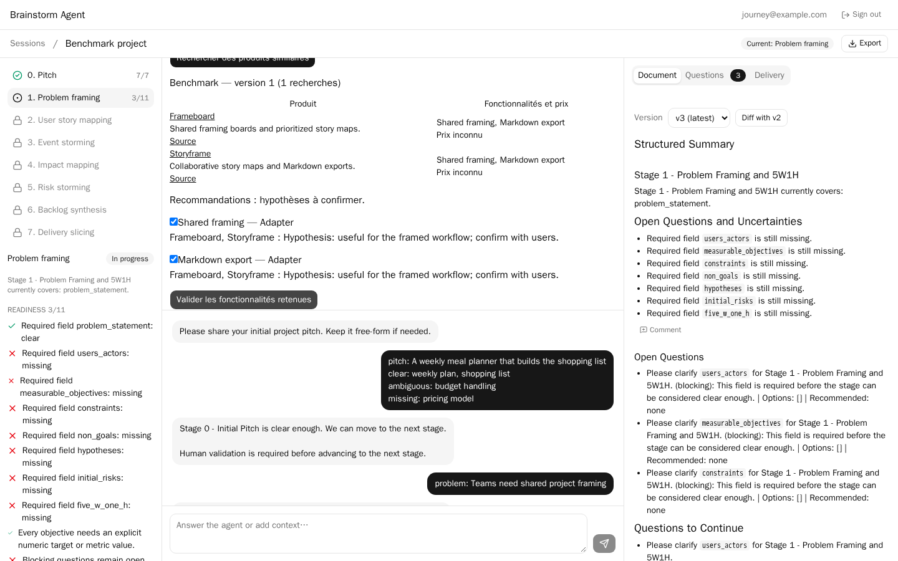

# Lot 10 validation evidence

All commands ran on codex-dev through `heavy` (formatting individual files excepted).

| Criterion | Observed evidence |
| --- | --- |
| Search adapters | 27 focused unit tests: provider contracts/selection, fake determinism, missing settings, timeout, 400, 500, invalid JSON and unsupported evidence. |
| Evidence filtering | `tests/unit/core/test_research.py` rejects a product whose URL is absent from actual results. |
| Persistence and API | SQLite integration suite passed; separate integration run against an isolated Postgres 17 database passed, including migration 0003, benchmark history and selection. Owner isolation includes all three research endpoints; unknown execution returns 404, invalid/stale selections return 409. |
| End to end | Backend fake flow selects two features, renders Benchmark, exports JSON/Markdown and captures selected candidates in stage 2 analysis context. Six Playwright journeys passed, including research, selecting two features, document update and persisted selection after reload. |
| Docker | Production Compose config valid. Built backend image, started pinned SearXNG, requested JSON from the backend container: 26 results. Test containers, networks and volumes removed. |
| Quality | Backend Ruff format/lint and ty passed; 184 unit, 45 integration (2 Postgres tests skipped in SQLite-only run), 14 end-to-end tests passed; combined coverage 93.63%. Separate Postgres run covered those skips. Frontend lint/typecheck passed; 123 unit tests passed. |

Research uses snippets only. Search availability depends on external engines; the fake provider keeps
all automated functional scenarios deterministic. The production SearXNG secret must be provisioned
by the deployment orchestrator before merge. No production credentials or services were modified.
